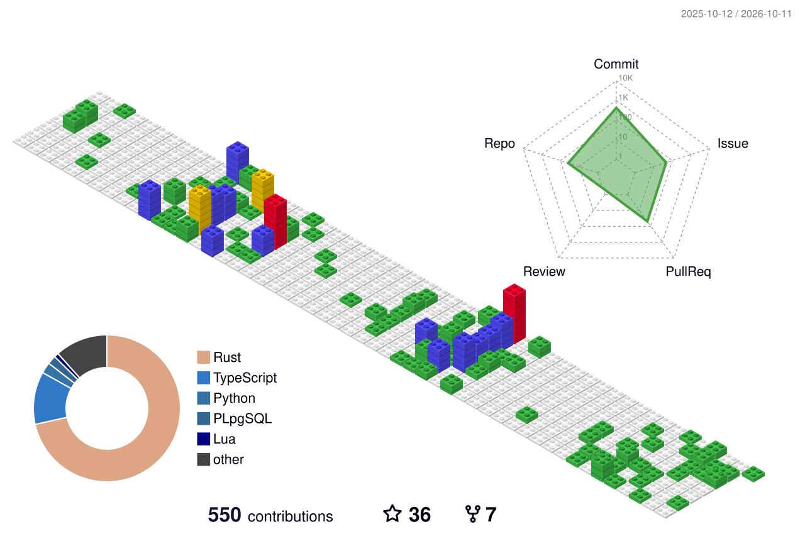

<h1 align="center">
  
  
  
  
  
  
  
  
  
  
  
  
  
  
  
  
  
  
  

<!--技能结束-->
 

---
### AI与智能体 - AI Agents
- [⭐dsh-dev-workflow](https://github.com/cherish-ltt/dsh-dev-workflow): dsh开发者工作流包：(Developer workflow toolkit for dsh)
- [⭐pi-dev-workflow](https://github.com/cherish-ltt/pi-dev-workflow): pi-agent开发者工作流包：git agents、代码评审、Karpathy 指南、主题(Developer workflow toolkit for pi: git agents, code review, Karpathy guidelines, themes)

### 缓存与存储 - Cache
- [lru-ovo](https://github.com/cherish-ltt/lru-ovo): 线程安全、异步友好的双层 LRU 缓存库，支持热 key 提升、serde 与快照迭代器 (A thread-safe, async-friendly two-tier LRU cache with hot-key promotion, serde support, and snapshot iterators)

### 视频格式工厂 - FfmpegTool
- [e2-ffmpeg-ovo](https://github.com/cherish-ltt/e2-ffmpeg-ovo): 基于 Tauri 2.0、React 18/19、TypeScript 与 Rust 的跨平台本地视频/音频处理工具 (A cross-platform native video/audio processing tool built on Tauri 2.0, React 18/19, TypeScript, and Rust)

### Guardian认证管理 - Guardian
- [⭐Guardian](https://github.com/cherish-ltt/Guardian): 基于 Axum+Vue 的后台管理认证系统 (Backend management authentication system based on Axum+Vue)

### Linux安全工具 - Linux
- [⭐U2Secure](https://github.com/cherish-ltt/U2Secure): Linux 服务器安全加固 CLI/TUI 工具 (Linux Server Security Hardening CLI/TUI Tools)

### 网络协议与通信 - Network
- [Kcp-ovo](https://github.com/cherish-ltt/kcp-ovo): KCP协议的纯Rust实现 - 快速可靠的ARQ协议 (Pure Rust Implementation of the KCP Protocol - A Fast and Reliable ARQ Protocol)
- [⭐LynnTcp](https://github.com/cherish-ltt/lynn_tcp): 一个轻量级的 TCP 服务器框架 (A lightweight TCP server framework)

### 后端框架与脚手架 - Scaffold
- [⭐AxumServiceScaffold](https://github.com/cherish-ltt/AxumServiceScaffold): 面向 axum + sea-orm 的 Rust 空白脚手架，采用DDD+洋葱架构 (A Rust skeleton for axum + sea-orm, adopting an onion architecture)
- [LongshipX](https://github.com/cherish-ltt/LongshipX): 基于 tokio + TCP/TLS 1.3 的 Rust 长连接游戏服务器后端,采用 DDD + 洋葱架构 组织为 Cargo workspace 多 crate 单体 (A Rust long-connection game server backend, based on tokio + TCP/TLS 1.3, is organized as a Cargo workspace with multiple crates in a monolithic structure using DDD + onion architecture)

### 时间轮任务调度系统 - Scheduled
- [LynnSundial](https://github.com/cherish-ltt/lynn_sundial): 一个支持cron的异步并发定时任务管理器 (An asynchronous concurrent scheduled task manager that supports cron)

### HideSomethingTool - Tool
- [hide-something](https://github.com/cherish-ltt/hide-something): 通过更改字母大小写将任意信息隐藏到文本载体中 (Hides arbitrary information into a text carrier by altering letter case)

### 正在参与 - Participating
- waiting
---

<!-- 

  
  
  
  
  
  

 -->

  Built with ❤️ by cherish-ltt(ghyper9023) 

<!--
### My Web

| blog                                    |                      home                       |                                     Guardian                |
| -------------------------------------- | ------------------------------------------------------------ | ------------------------------------------------------------ | 
| [click](https://blog.65432123.xyz) | [click](https://www.25131425.xyz) | [click](https://guardian.25131425.xyz) |

---
